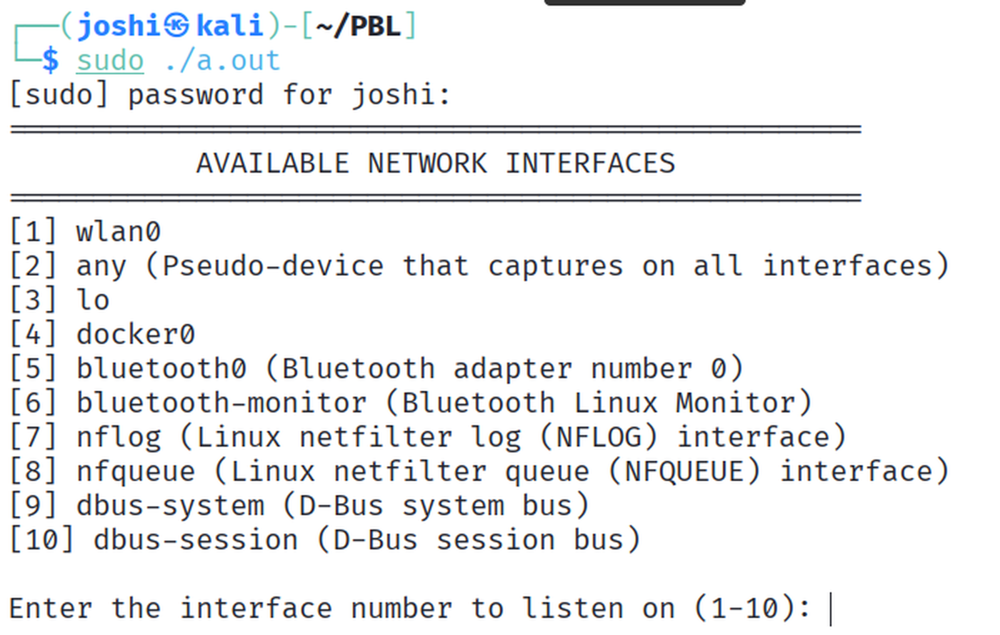
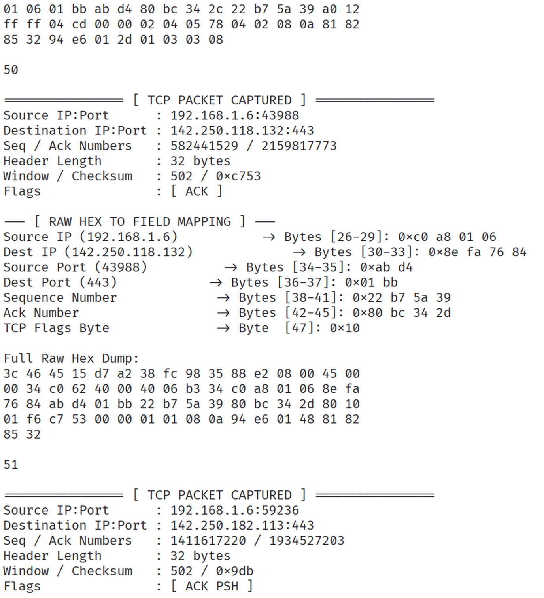
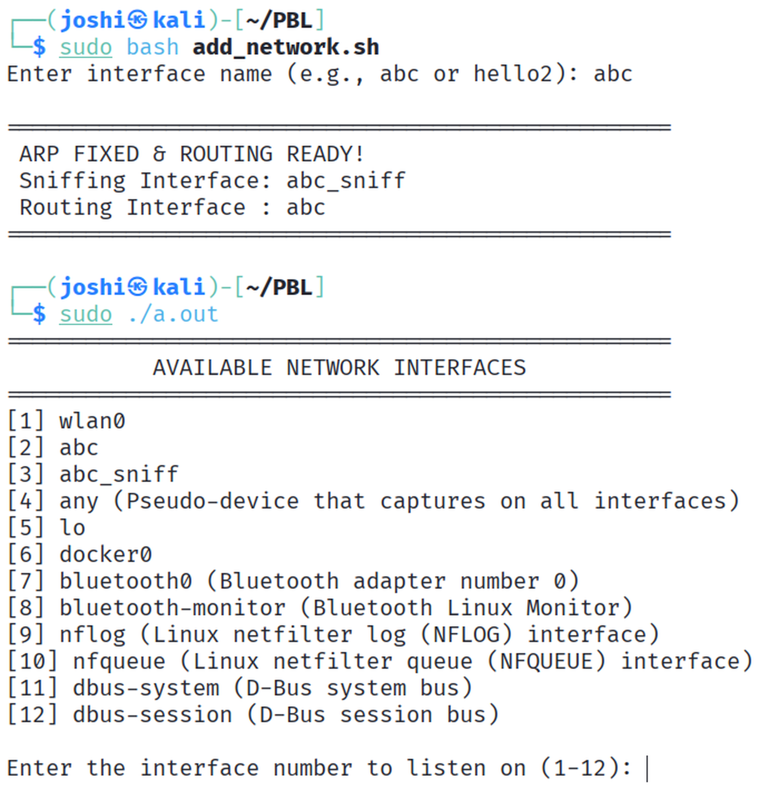
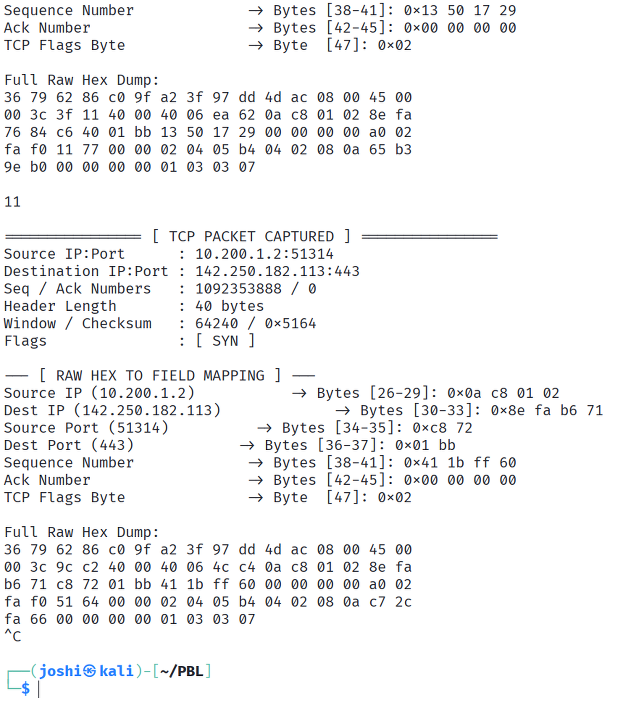

# PROJECT TEST REPORT: Multithreaded TCP Packet Sniffer & Analyzer (Team T086)

This document outlines the testing and validation status of the C++ network packet sniffer and TCP header analyzer. All tests were conducted in a controlled virtual environment to verify module reliability, memory layout precision, and thread safety.

---

## Test Summary Table

| # | Test Case | Status | Notes |
|---|-----------|--------|-------|
| 1 | Valid TCP packet capture | PASS | `pcap_loop` correctly passes Ethernet frames; IP addresses and TCP ports parse accurately via `ntohs`/`ntohl` conversions. |
| 2 | Non-TCP IPv4 filtering | PASS | Non-TCP traffic (such as UDP and ICMP) is filtered and dropped early by checking `ip->protocol != 6`. |
| 3 | TCP header offset calculation | PASS | Options and variable padding lengths are calculated dynamically using the TCP Data Offset field. |
| 4 | Thread consumer-producer synchronization | PASS | The thread-safe `CircularRingBuffer` uses `std::mutex` and `std::condition_variable` to manage concurrent access without data corruption or race conditions. |
| 5 | Addition of new interfaces (dynamically) | PASS | Local network adapters are dynamically listed via `pcap_findalldevs`, allowing interactive interface selection and smooth TCP traffic routing. |

---

## Test Evidence

### Test 5 (part 1): Interface discovery via `pcap_findalldevs`

### Tests 1 and 3: Valid TCP packet capture and header parsing

### Test 5 (part 2): New interface added dynamically

### Tests 1 and 3: Capture on the new interface (SYN packet, 40-byte header)

---

## Conclusion

All core architectural components, including live capture, ring buffer queue management, and deep TCP parsing, have passed validation and are stable under test traffic loads.
